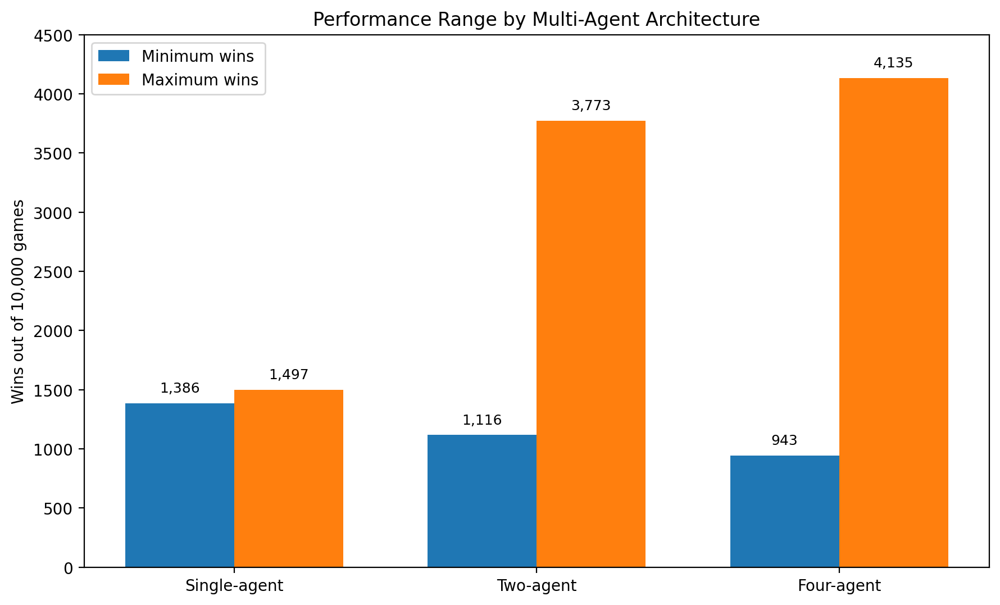

# Research: Delegating Decision-Making in Schnapsen

## Research Question

> How does the number of delegated agents influence the relative performance of a Schnapsen-playing intelligent system?

## Objective

This study investigates whether decomposing Schnapsen decision-making into specialized sub-problems can improve the performance of an intelligent game-playing system.

The game was divided according to two dimensions:

- **Game phase**
  - Phase 1: imperfect information
  - Phase 2: perfect information
- **Player role**
  - Leading
  - Following

Different agents were assigned to these decision-making contexts and evaluated against an Rdeep baseline.

## Experimental Design

Three levels of agent delegation were evaluated:

| System | Configurations |
|---|---:|
| Single-agent | 3 |
| Two-agent | 12 |
| Four-agent | 24 |
| **Total** | **39** |

Each configuration was evaluated over **10,000 games**. The primary performance measure was the number of games won. Total game score was also recorded as a secondary measure.

The experiment used controlled random seeds and consistent game conditions across configurations.

## Agents

The system used four types of agents:

- **Rdeep Bot** — Monte Carlo-based decision making
- **Machine Learning Bot** — supervised learning agent trained using gameplay data
- **Heuristic Bot 1** — rule-based agent
- **Heuristic Bot 2** — rule-based agent

## Results

The results showed that the relationship between the number of delegated agents and performance was **not linear**.

Increasing the number of agents increased the range of possible performance rather than consistently improving it.

| Architecture | Minimum wins | Maximum wins |
|---|---:|---:|
| Single-agent | 1,386 | 1,497 |
| Two-agent | 1,116 | 3,773 |
| Four-agent | 943 | 4,135 |

The best-performing configuration was **BADC**, achieving:

**4,135 wins out of 10,000 games (41.35%)**

The statistical analysis reported a repeated-measures ANOVA p-value of:

**p = 1.3 × 10⁻⁸**

indicating a statistically significant effect of the number of delegated agents on system performance.

## Agent Specialization

The role-specific analysis revealed substantial differences in agent performance depending on where an agent was used.

### Rdeep

Rdeep performed particularly strongly when:

- operating in Phase 1
- following the opponent

This role provides information about the opponent's played card while the game still contains uncertainty.

### Machine Learning Agent

The ML agent performed particularly well when:

- leading in Phase 1

However, its performance was substantially weaker when following.

### Heuristic Agents

Both heuristic agents performed particularly strongly in Phase 2, where the game provides perfect information about the opponent's cards.

## Best Configuration

The best configuration was **BADC**:

| Context | Agent |
|---|---|
| Phase 1 — Leading | ML Bot |
| Phase 1 — Following | Rdeep Bot |
| Phase 2 — Leading | Heuristic Bot 2 |
| Phase 2 — Following | Heuristic Bot 1 |

Changing the allocation of agents had a substantial effect.

For example, swapping the ML and Rdeep positions produced configuration **ABDC**, reducing performance from 4,135 wins to 1,559 wins.

Swapping the two heuristic agents produced **BACD**, with 3,922 wins.

This demonstrates that the performance of the multi-agent system depended not only on **which agents were used**, but also on **where they were deployed**.

## Key Findings

The experiment suggests that:

1. More agents do not automatically produce better performance.
2. Specialized agents can complement one another when assigned to appropriate decision-making contexts.
3. Agent allocation can be more important than simply increasing the number of agents.
4. Different agents exhibited distinct strengths depending on the information available and their role in the game.

## Limitations

The study was conducted using a fixed set of agent types and a limited number of architectural conditions.

The results therefore do not establish that the same relationships would necessarily hold for other agent architectures or alternative ways of decomposing the game.

## Takeaway

The project demonstrates a practical approach to **multi-agent system design through specialization and delegation**.

Rather than relying on a single general-purpose agent, the system assigns different decision-making responsibilities to agents according to their observed strengths.

The results show that effective multi-agent design depends on **careful coordination and role allocation**, not simply on increasing the number of agents.

## Performance Visualization

The experiment showed that increasing the number of agents increased the range of possible performance rather than consistently improving results.

